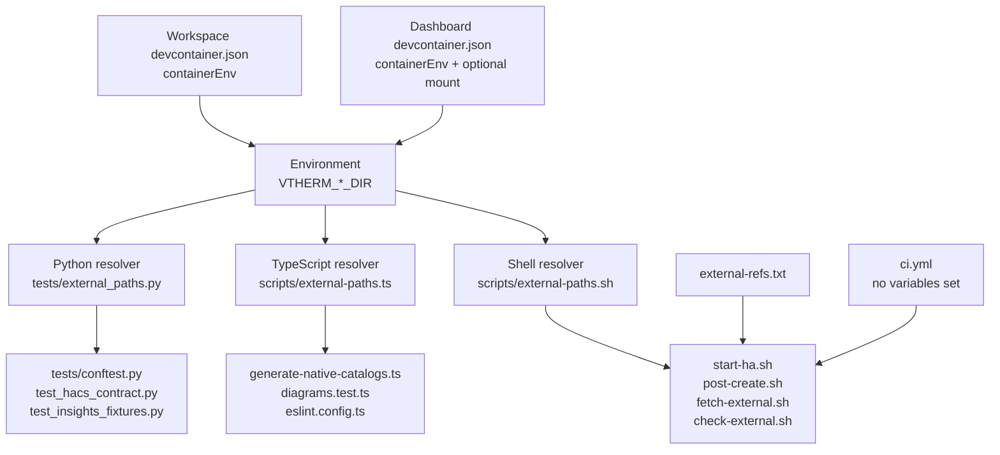

# Design Document

## Overview

The `vtherm_dashboard` project reads the code of three External_Projects (Versatile Thermostat, `vtherm_api`, HACS). Today each consumer builds the path `external/<name>` by itself, and three different mechanisms (clones, workspace symlinks, a Windows bind mount) fill that folder.

This design replaces the link mechanism with one rule: the folder of an External_Project is the value of its Location_Variable, or its Default_Location when the variable is blank.

| External_Project | Location_Variable | Default_Location |
|---|---|---|
| Versatile Thermostat | `VTHERM_VERSATILE_THERMOSTAT_DIR` | `external/versatile_thermostat` |
| `vtherm_api` | `VTHERM_API_DIR` | `external/vtherm_api` |
| HACS | `VTHERM_HACS_DIR` | `external/hacs` |

The design has four parts:

1. Three small Path_Resolvers (Python, TypeScript, shell) that implement the same rule.
2. A check command that prints the resolved folders and their status.
3. Changes to the devcontainers, `fetch-external.sh`, CI, ESLint and `.gitignore`.
4. Documentation updates.

No code is changed by this document. Research was limited to the existing files of the repository (`scripts/fetch-external.sh`, `external-refs.txt`, both `post-create.sh` files, `start-ha.sh`, both `devcontainer.json` files, `tests/conftest.py`, `tests/test_hacs_contract.py`, `scripts/generate-native-catalogs.ts`, `frontend/test/diagrams.test.ts`, `eslint.config.ts`, `ci.yml`). Findings that shape the design:

- `fetch-external.sh` reads `external-refs.txt` (only `versatile_thermostat` and `hacs`) and skips any existing `external/<name>`. The dashboard `post-create.sh` clones `vtherm_api` on its own, outside this script, with `VTHERM_API_REPO`/`VTHERM_API_REF`.
- The workspace `post-create.sh` (lines 173 to 184) creates the two symlinks and runs `fetch-external.sh` with `|| warn`, so a HACS failure does not stop it today. Requirement 3.6 changes that.
- The workspace root has no `hacs` folder. Requirement 3.3 is therefore conditional and `VTHERM_HACS_DIR` is not set in the workspace `devcontainer.json`. HACS is fetched into its Default_Location.
- `start-ha.sh` has a `link` function that prints `Skipped (missing): <source>` and continues, exit status unchanged. Requirement 8.2 keeps this behavior and changes the message.
- The repository has no property-based testing library. The design adds `hypothesis` (Python) and `fast-check` (TypeScript) as dev dependencies.

## Architecture



Design decisions:

- **Three resolvers, one rule.** The consumers run in three runtimes, and none can call another without a process spawn. Three short implementations are kept in line by a cross-language test (Property 5) rather than by code generation.
- **Lexical path normalization, no symlink resolution.** Python `os.path.normpath`, Node `path.resolve`, and `realpath -m -s` in shell all collapse `.`, `..`, repeated and trailing slashes without touching the file system. This makes byte-for-byte agreement (requirement 9.6) achievable.
- **Resolve separates from validate.** `locate(name)` is pure (environment in, absolute path out). `resolve(name)` calls `locate` and then checks that the folder exists. The check command and the skip reasons use `locate`, so they can print a path that does not exist.
- **Value is not trimmed.** A value that is blank (empty or only whitespace) counts as unset. Any other value is used exactly as given, so a path with leading or trailing spaces is kept as is.
- **Defaults live in each resolver.** This is the one place where `external/` may appear (requirement 5.6).
- **Workspace container keeps symlink-free layout.** The Workspace_Devcontainer sets the variables to the sibling submodules. HACS has no submodule, so it uses the default and is fetched.
- **`vtherm_api` joins `external-refs.txt`.** Requirement 4.4 asks that `fetch-external.sh` fetch `vtherm_api` like the others. A line `vtherm_api <url> <ref>` is added with the ref `main` at first, which matches the current unpinned clone. Pinning to a commit is a later choice for the maintainer. CI calls `fetch-external.sh versatile_thermostat hacs` so that it still fetches only the two projects it uses and installs `vtherm_api` from the published package.

## Components and Interfaces

### Python resolver: `tests/external_paths.py`

```python
PROJECT_ROOT: Path                      # parent of tests/
LOCATIONS: Mapping[str, Location]       # "versatile_thermostat" | "vtherm_api" | "hacs"

@dataclass(frozen=True)
class Location:
    name: str          # "hacs"
    variable: str      # "VTHERM_HACS_DIR"
    default: str       # "external/hacs"

class ExternalProjectError(Exception): ...   # message names variable and path

def locate(name: str, environ: Mapping[str, str] = os.environ, root: Path = PROJECT_ROOT) -> Path
def resolve(name: str, environ=os.environ, root=PROJECT_ROOT) -> Path     # raises ExternalProjectError
def skip_reason(name: str, environ=os.environ, root=PROJECT_ROOT) -> str | None
```

`locate`: take `environ.get(variable, "")`. If `value.strip() == ""`, use `default`. Return `Path(os.path.normpath(os.path.join(root, value)))`. Joining an absolute `value` yields `value`, so absolute and relative cases share one code path.

`resolve`: call `locate`. If the path is not a directory, raise `ExternalProjectError` naming the variable and the path. The message differs only in the origin: "set to" or "default of" (requirements 1.6 and 1.7). There is no fallback from a set variable to the default.

`skip_reason`: returns `None` when the folder exists, otherwise `"<VARIABLE>: <path> is not available"`. `conftest.py` builds `EXTERNAL_VTHERM = locate("versatile_thermostat") / "custom_components"` and `requires_vtherm = pytest.mark.skipif(..., reason=...)` from it. `test_hacs_contract.py` does the same for HACS. `test_insights_fixtures.py` uses the same marker. The `vtherm` marker in `pyproject.toml` keeps its name and its selection. Only its description text changes (`external/` is replaced by the variable name).

### TypeScript resolver: `scripts/external-paths.ts`

```ts
export interface Location { name: string; variable: string; default: string }
export const LOCATIONS: Record<ProjectName, Location>;
export function locate(name: ProjectName, env = process.env, root = ROOT): string;
export function resolve(name: ProjectName, env = process.env, root = ROOT): string; // throws ExternalProjectError
```

`locate` uses `path.resolve(root, value)` after the same blank test. `resolve` checks `fs.statSync(path).isDirectory()`.

Consumers:

- `scripts/generate-native-catalogs.ts` replaces `VTHERM_TRANSLATIONS` with `path.join(locate("versatile_thermostat"), "custom_components/versatile_thermostat/translations/")`. When the folder is missing, the error on stderr is `VTHERM_VERSATILE_THERMOSTAT_DIR: <path> has no Versatile Thermostat translations`. The script exits with code 1 before it writes any catalog file (requirement 5.5). The check happens before the first write.
- `frontend/test/diagrams.test.ts` replaces `VT_DIR` with the resolved folder. `frontend/` is a different package from `scripts/`. The test imports the resolver through a relative path (`../../scripts/external-paths`), and the `tsconfig`/vitest include must cover it.
- `eslint.config.ts` builds its `ignores` list with `externalIgnores(env, root)`: the glob `external/**` always, plus `<relative-path>/**` for each Location_Variable whose resolved folder lies inside the project root and is not already under `external/`. A folder outside the root adds nothing.

### Shell resolver: `scripts/external-paths.sh`

A file meant to be sourced. It defines:

```bash
external_variable NAME      # prints VTHERM_HACS_DIR
external_default NAME       # prints external/hacs
external_locate NAME        # prints the absolute normalized path; uses $VTHERM_PROJECT_ROOT or the parent of scripts/
external_resolve NAME       # like external_locate, returns 1 and prints the error on stderr when the folder is missing
```

`external_locate` reads the variable by indirection. A blank value (`[[ -z "${value//[[:space:]]/}" ]]`) selects the default. The path is then `realpath -m -s -- "$root/$value"`. Joining with `$root/` is safe for absolute values only if the leading slash is handled: for an absolute value, the function uses the value directly.

Consumers:

- `.devcontainer/start-ha.sh` sources it and calls `external_locate versatile_thermostat`. It links `<folder>/custom_components/versatile_thermostat`. When the source is missing, it prints one line `VTHERM_VERSATILE_THERMOSTAT_DIR: <checked path> has no Versatile Thermostat integration, link skipped`, creates nothing, and goes on. The exit status is the same as today.
- `.devcontainer/post-create.sh` (dashboard) runs `bash scripts/fetch-external.sh` for all three projects (no direct `git clone`), then `python -m pip install -e "$(external_locate vtherm_api)"`.
- `scripts/fetch-external.sh`: see below.

### Check command: `scripts/check-external.sh`, `npm run check:external`

For each project in a fixed order it prints one line `<VARIABLE> <absolute path> exists|missing`, never creates or writes anything, and exits 1 when at least one status is `missing` after printing every line (requirements 9.1 to 9.4). It only calls `external_locate` and `test -d`, so it runs in a few milliseconds.

### `scripts/fetch-external.sh`

Signature: `fetch-external.sh [name ...]`. With no argument it handles every line of `external-refs.txt`. With arguments, only the named projects (used by CI and by the workspace post-create).

For each project:

1. If its Location_Variable is non-blank: print `<name>: using <path> (VTHERM_..._DIR)` to stdout and skip. The folder is not read or changed (requirement 4.2).
2. Otherwise the target is the Default_Location, computed with `external_locate`. If the folder exists: print `<name> exists, left as it is` and skip (4.3).
3. Otherwise clone into a temporary folder `external/.<name>.tmp.$$`, using the existing shallow `git init`, `fetch --depth 1`, `checkout FETCH_HEAD` sequence, with `*_REPO` and `*_REF` overriding the line of the refs file (4.1, 4.5). On success the temporary folder is renamed to the target. On any failure, the temporary folder is removed, the message `<name>: <step> failed (<url> at <ref>)` goes to stderr, and the script remembers the failure. Using a temporary folder is what guarantees that no partial folder remains (4.6).
4. After the loop, the script exits 1 if any project failed. Other projects are still tried.

### Workspace devcontainer

`/workspaces/vtherm-workspace/.devcontainer/devcontainer.json` gets:

```jsonc
"containerEnv": {
    // existing entries kept
    "VTHERM_VERSATILE_THERMOSTAT_DIR": "${containerWorkspaceFolder}/versatile_thermostat",
    "VTHERM_API_DIR": "${containerWorkspaceFolder}/vtherm_api"
}
```

`VTHERM_HACS_DIR` is not set because the workspace has no `hacs` folder (requirement 3.3). `/workspaces/vtherm-workspace/.devcontainer/post-create.sh` replaces its "Dashboard tests" block:

```bash
cleanup_external_links vtherm_dashboard/external      # removes symlinks only
if [ -z "${VTHERM_HACS_DIR//[[:space:]]/}" ]; then
    bash vtherm_dashboard/scripts/fetch-external.sh hacs || { echo "ERROR: fetching HACS failed" >&2; HACS_FAILED=1; }
fi
...
exit "${HACS_FAILED:-0}"   # after all other steps
```

The variable test in the workspace script treats an empty value as unset (3.4); a non-empty value skips the fetch and never touches the folder (3.5). The HACS failure is deferred to the end of the script so that the other environment steps still run, while the final exit code is non-zero (3.6). The existing `pip install -e vtherm_api` line already uses the submodule and stays as is.

`cleanup_external_links DIR` handles each direct child of `DIR`. A symlink is removed with `rm -- "$entry"` (never `rm -r` and never followed), and `Removed link <name>` is printed. A regular folder or file is left alone and silent. If `rm` fails, `Could not remove link <name>` is printed, the loop goes on, and the function returns 1. Running it twice gives the same state and exit code 0, since the second run finds no symlinks.

### Dashboard devcontainer

`vtherm_dashboard/.devcontainer/devcontainer.json`: the two `C:\VS-Projects` bind mounts are removed. Nothing is set in `containerEnv` by default, so a standalone contributor gets the fetch into `external/`. The documentation shows how to add a mount and a variable together. A commented-out example inside the JSON would still contain a host path, so the example lives only in the documentation (requirement 2.3).

### CI: `.github/workflows/ci.yml`

Both fetch steps become `bash scripts/fetch-external.sh versatile_thermostat hacs`. The workflow has no `env:` entry for a Location_Variable, so the Default_Location applies (6.3). The script exits non-zero on a failed fetch, which fails the step before tests (6.2), and nothing falls back to a branch head or cache because the clone is always a pinned shallow fetch. The comment about `external/` in the diagrams step is reworded to name the variable.

### `.gitignore`

The existing `/external/` entry already hides everything under the folder. It is kept (requirement 8.5).

### Documentation

`docs/contributing/development-environment.md` gets a table of the three variables (name, one-sentence meaning, Default_Location), an example of `containerEnv`, and an example with a `mounts` entry (`type=bind,source=<host folder>,target=/mnt/versatile_thermostat`) plus `"VTHERM_VERSATILE_THERMOSTAT_DIR": "/mnt/versatile_thermostat"`. The check command is described there too. Mentions of `external/` in `ci.md`, `setting-insights.md`, `complements.md`, `config-flow-driver.md`, `dev-mode.md` and `docs/README.md` are replaced by a reference to the variable, except mentions that do not describe the location of a project, which stay and are listed in the change record (7.6). The workspace README gets one entry per variable that the workspace container sets (3.7).

## Data Models

**Location** (same fields in each language): `name`, `variable`, `default`.

**Registry** (fixed, three entries):

```
versatile_thermostat -> VTHERM_VERSATILE_THERMOSTAT_DIR, external/versatile_thermostat
vtherm_api           -> VTHERM_API_DIR,                   external/vtherm_api
hacs                 -> VTHERM_HACS_DIR,                  external/hacs
```

**Environment value** (input of every resolver): a string or unset. Classification:

| Value | Meaning |
|---|---|
| unset, `""`, whitespace only | blank, the Default_Location applies |
| starts with `/` | absolute, used as is after normalization |
| anything else | relative, joined to the project root |

**Check line**: `<VARIABLE> <absolute path> <exists|missing>`.

**`external-refs.txt`** keeps one line per project: `name url ref`. A line for `vtherm_api` is added.

## Correctness Properties

*A property is a characteristic or behavior that should hold true across all valid executions of a system-essentially, a formal statement about what the system should do. Properties serve as the bridge between human-readable specifications and machine-verifiable correctness guarantees.*

Prework reflection: criteria 1.3 and 1.4 collapse into one property (blank means default). Criteria 1.2, 1.5 and the normalization part of 9.6 collapse into one property on set values. Criteria 5.2 and 5.3 reduce to the cross-language agreement of 9.6. Criteria 9.1 to 9.4 collapse into one property on the check command. Criteria 2.4, 2.5 and 2.7 collapse into one property on the link cleanup. The remaining criteria are examples or edge cases (see Testing Strategy).

### Property 1: Blank variable resolves to the default

*For any* project and *for any* environment in which its Location_Variable is unset, empty, or made only of whitespace characters, `locate` SHALL return the Default_Location joined to the project root and normalized, the same result for each of those blank forms.

**Validates: Requirements 1.3, 1.4**

### Property 2: Set value resolves to a normalized absolute path independent of the working directory

*For any* project, *for any* non-blank path value (absolute or relative, with or without a trailing slash, with spaces) and *for any* current working directory, `locate` SHALL return an absolute normalized path equal to the value when absolute, or to the value joined to the project root when relative, and `resolve` SHALL return that same path when the folder exists, whatever its contents.

**Validates: Requirements 1.2, 1.5**

### Property 3: A set variable that is not a folder is an error without fallback

*For any* project and *for any* value that names a missing path or a file, `resolve` SHALL raise an error whose message contains the variable name and the path, and SHALL NOT return the Default_Location, even when the Default_Location exists.

**Validates: Requirements 1.6**

### Property 4: A missing default is an error

*For any* project whose Location_Variable is blank and whose Default_Location is not a folder, `resolve` SHALL raise an error whose message contains the variable name and the Default_Location path.

**Validates: Requirements 1.7**

### Property 5: The three resolvers agree

*For any* project and *for any* variable value (absolute, relative, with a trailing slash, with spaces, empty, or unset), the Python, TypeScript and shell resolvers SHALL return the same absolute path, byte for byte.

**Validates: Requirements 5.2, 5.3, 9.6**

### Property 6: The check command reports every project and its exit code follows the folders

*For any* combination of states of the three variables (unset, set to an existing folder, set to a missing path), the check command SHALL print exactly one line per project containing the variable name, the resolved absolute path and a status that is `exists` if and only if that path is a folder, and SHALL exit with code 0 if and only if all three statuses are `exists`, otherwise 1.

**Validates: Requirements 9.1, 9.2, 9.3, 9.4**

### Property 7: Link cleanup removes links only and is idempotent

*For any* folder whose direct children are a mix of symbolic links and regular folders or files, `cleanup_external_links` SHALL remove every symbolic link without changing its target, print one message containing the name of each removed link and none for the other entries, leave every regular entry and its contents unchanged, and exit with code 0. Running it a second time SHALL change nothing and exit with code 0.

**Validates: Requirements 2.1, 2.4, 2.5, 2.7**

### Property 8: ESLint ignores every folder of a variable that lies inside the project

*For any* project root and *for any* Location_Variable value, `externalIgnores` SHALL contain a glob that covers every file under the resolved folder when that folder lies inside the root, and SHALL add no glob for it when the folder lies outside the root. The list SHALL always contain `external/**`.

**Validates: Requirements 8.3, 8.4**

## Error Handling

| Situation | Behavior |
|---|---|
| Variable set to a missing path or a file | Python `ExternalProjectError`, TypeScript `ExternalProjectError`, shell message on stderr and return 1. Message names the variable and the path. No fallback. |
| Variable blank and default folder missing | Same error, with the Default_Location. |
| Python test needs a missing project | The test is skipped with reason `<VARIABLE>: <path> is not available`, never failed or errored. |
| `generate-native-catalogs.ts` cannot find translations | stderr names `VTHERM_VERSATILE_THERMOSTAT_DIR` and the path, exit 1, no catalog written. |
| `start-ha.sh` cannot find the integration | One console line naming the variable and checked path, no link created or changed, exit status as today. |
| `fetch-external.sh` clone fails | Temporary folder removed, stderr names project and failed step, other projects still tried, exit 1. |
| Workspace HACS fetch fails | stderr names HACS, other steps continue, final exit code non-zero. |
| Symlink removal fails | Message with the link name, the loop continues, exit non-zero. |
| Check command finds a missing folder | Status `missing`, remaining projects still printed, exit 1. |

A relative path resolved against the project root can differ from the user's expectation when the user thinks in terms of the current directory. The documentation states the rule once.

## Testing Strategy

Property-based testing applies to the resolvers, the check command, the cleanup function and the ESLint ignore builder: they are small functions of environment and file system state with a large input space (path strings, variable states). It does not apply to the devcontainer and CI configuration, the documentation edits, the clone steps (network and git), or `start-ha.sh` linking. Those use example-based and static tests.

**Libraries:** `hypothesis` for Python and shell-through-subprocess properties, `fast-check` for TypeScript. Both are added as dev dependencies. Each property is one property-based test with at least 100 iterations (`max_examples=100`, `numRuns: 100`). Each test carries a comment with the tag `Feature: external-off, Property <n>: <text>`. Temporary folders (`tmp_path`, `fs.mkdtempSync`) hold the generated trees, and they are never inside the real `external/`.

**Property tests**

| Property | Where | Generators |
|---|---|---|
| 1, 2, 3, 4 | `tests/test_external_paths.py` (Python), `scripts/external-paths.test.ts` (TypeScript) | Path strings with spaces, `.`/`..` segments, trailing slashes, whitespace-only strings; temp roots with and without default folders |
| 5 | `tests/test_external_paths_agreement.py` | Same strings; runs the TypeScript resolver with `node` and the shell resolver with `bash`, compares to Python |
| 6 | `tests/test_check_external.py` | Three variables, each unset, existing folder or missing path; runs `scripts/check-external.sh` |
| 7 | `tests/test_cleanup_external_links.py` | Random mixes of symlinks (to files, folders, dangling) and regular entries |
| 8 | `scripts/external-paths.test.ts` | Roots and values inside and outside the root |

**Example and edge-case tests**

- Registry has three variables with unique names (1.1).
- Static checks: dashboard `devcontainer.json` has no mount onto `external` and no Windows drive or home path (2.2, 2.3); workspace `devcontainer.json` `containerEnv` values (3.1 to 3.3); the dashboard `post-create.sh` has no `git clone` and calls `fetch-external.sh` (4.4); no `external/` string in any consumer outside the resolvers (5.6); CI has no Location_Variable (6.3); ESLint ignore list contains `external/**` (8.3); `git check-ignore external/hacs` succeeds (8.5).
- Workspace post-create with a stubbed `fetch-external.sh`: HACS variable unset, set, and failing (3.4 to 3.6). A read-only parent folder makes the link removal fail (2.6).
- `fetch-external.sh` with local `file://` repositories: clone at pinned ref, `*_REF`/`*_REPO` override, variable set (path printed, folder unchanged), existing folder with uncommitted changes untouched, unreachable URL and unknown ref (no partial folder, stderr names project) (4.1 to 4.3, 4.5, 4.6).
- pytest in a subprocess with a missing folder: skipped with the reason (5.4). `pytest -m vtherm --collect-only` selects the same tests before and after (5.7).
- `generate-native-catalogs.ts` with a bad variable: stderr text, exit 1, existing catalogs unchanged (5.5).
- `start-ha.sh` against a temporary tree with a stubbed `hass`: link created, or skipped with the message (8.1, 8.2).
- Check command: runs in under 5 seconds and leaves the tree unchanged (9.5).
- Documentation: a test that the variables of the registry all appear in `development-environment.md`, that the listed docs contain no `external/`, and that the workspace README lists each variable of `containerEnv` (3.7, 7.1 to 7.5).

**Not covered by automated tests:** CI behavior on GitHub (6.1, 6.2, 6.4, 6.5) is checked by running the workflow once after the change. Criterion 7.6 is a review item of the change record.
